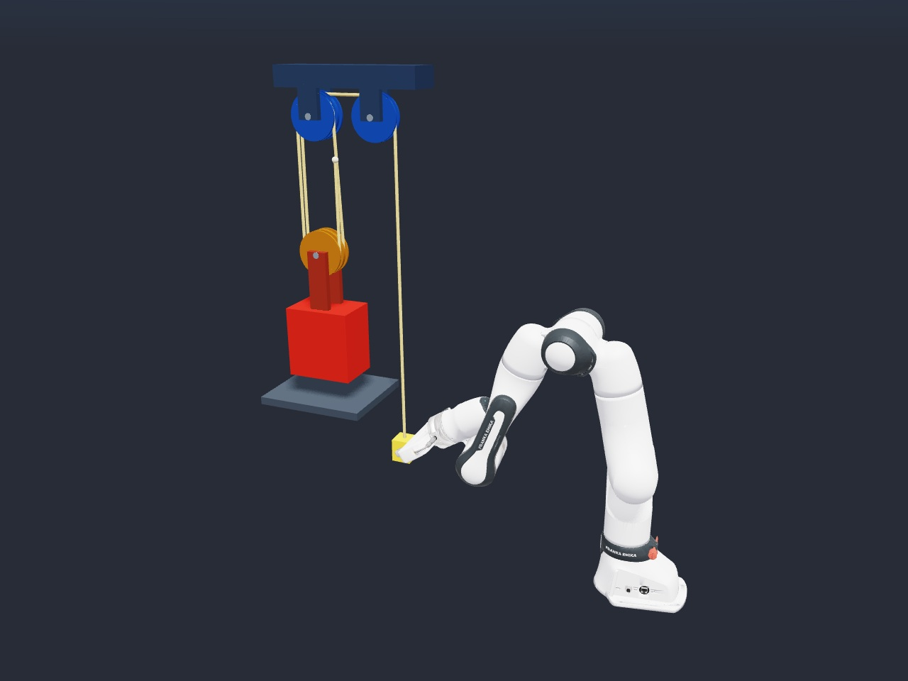

# Newton Samples

[](https://opensource.org/licenses/Apache-2.0)
[](https://github.com/NVIDIA/newton-samples/actions/workflows/quality.yml?query=branch%3Amain+event%3Apush)
[](https://github.com/NVIDIA/newton-samples/actions/workflows/tests.yml?query=branch%3Amain+event%3Apush)

Newton Samples is a collection of more complex physics simulation samples from
NVIDIA DevTech built with [Newton](https://github.com/newton-physics/newton), the
GPU-accelerated physics simulation engine built on
[NVIDIA Warp](https://github.com/NVIDIA/warp). The samples demonstrate how to
combine Newton's solvers, robotics tools, and multiphysics coupling in complete
simulation scenes.

This repository builds on the
[examples in the Newton repository](https://github.com/newton-physics/newton#examples).
For the engine's API and user guides, see the
[Newton documentation](https://newton-physics.github.io/newton/stable/).

## Requirements

- Python 3.10 or newer; Python 3.12 is recommended for the locked environment.
- [uv](https://docs.astral.sh/uv/getting-started/installation/) for environment setup.
- An NVIDIA GPU with a compatible driver is recommended for CUDA acceleration.
- A working graphics display for the interactive OpenGL viewer.
- Internet access and Git on `PATH` to download robot assets on first use.

The project depends on `newton[examples]>=1.6.0`. The included lockfile pins the
tested versions of Newton, Warp, MuJoCo, MuJoCo Warp, and the viewer dependencies.
See Newton's [installation guide](https://newton-physics.github.io/newton/stable/guide/installation.html)
for detailed platform, GPU, and driver requirements.

## Quickstart

Clone the repository and install the locked dependencies:

```bash
git clone https://github.com/NVIDIA/newton-samples.git
cd newton-samples
uv sync --locked --python 3.12
```

Choose a sample below for launch instructions, configuration, and validation.

## Examples

<table>
  <tr>
    <td colspan="3"><h3>Multiphysics</h3></td>
  </tr>
  <tr>
    <td align="center" width="33%">
      <a href="docs/examples/franka_pulley_mechanical_advantage.md">
        
      </a>
    </td>
    <td width="33%"></td>
    <td width="33%"></td>
  </tr>
  <tr>
    <td align="center" width="33%">
      <a href="docs/examples/franka_pulley_mechanical_advantage.md">Franka Pulley Mechanical Advantage</a>
    </td>
    <td width="33%"></td>
    <td width="33%"></td>
  </tr>
</table>

## Contributing

This project is currently not accepting contributions. See
[CONTRIBUTING.md](CONTRIBUTING.md).

## License

The sample code is licensed under [Apache 2.0](LICENSE.md). Dependencies and
downloaded assets retain their respective licenses. The example runner includes
code adapted from Newton with its upstream copyright headers preserved.
[Third-party notices](THIRD_PARTY_NOTICES.md) document the included code,
dependencies, and downloaded assets.
