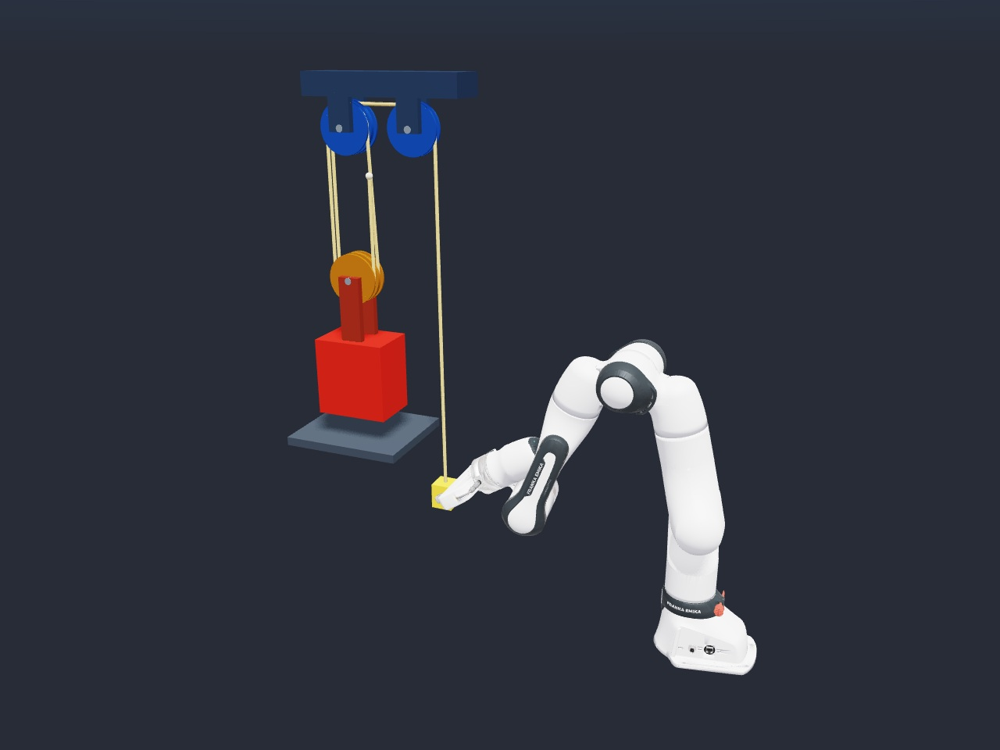

# Franka Pulley Mechanical Advantage

[Back to Newton Samples](../../README.md#examples) ·
[Source](../../examples/multiphysics/example_franka_pulley_mechanical_advantage.py)



A MuJoCo-simulated Franka robot follows an inverse-kinematics trajectory,
grasps a box attached to the free end of a VBD cable, and pulls downward 0.4 m to
raise a guided load. Fixed and moving multi-sheave pulley blocks provide the
mechanical advantage. ADMM coupling transfers contact forces between the robot
and mechanism; the robot has no fixed attachment to the cable.

## Run

After completing the repository's [setup](../../README.md#quickstart), launch
the default 4:1 mechanism with a 5 kg load:

```bash
uv run -m examples franka_pulley_mechanical_advantage --viewer gl
```

Configure the supporting-strand count (an even integer of at least 2) and load:

```bash
uv run -m examples franka_pulley_mechanical_advantage --mechanical-advantage 6 --weight-mass 5
uv run -m examples franka_pulley_mechanical_advantage --help
```

The Franka URDF and meshes are downloaded by `newton.utils.download_asset`
from Newton's public asset collection on first use. The first run requires
internet access and Git on `PATH`. The pulley, cable, and weight are generated in
Python; no local asset files or Git LFS setup are required. The URDF and meshes
are not bundled in this repository or its Python package. See
[third-party notices](../../THIRD_PARTY_NOTICES.md) for the asset's source, pinned
revision, and upstream Apache-2.0 license and additional Willow Garage BSD notice.

## Configuration and Measurements

| Option | Description | Default |
| --- | --- | --- |
| `--mechanical-advantage` | Even supporting-strand count, at least 2. | `4` |
| `--weight-mass` | Intended net lifted mass in kilograms. | `5` |
| `--substeps` | Coupled integration substeps per frame. | `16` |
| `--vbd-iterations` | VBD iterations per coupled substep. | `10` |

The runner follows Newton's example command-line conventions. Common options
include:

| Option | Description |
| --- | --- |
| `--viewer gl` | Open the interactive OpenGL viewer (default). |
| `--viewer null` | Run without rendering. |
| `--device cuda:0` | Select the compute device. |
| `--num-frames <count>` | Set the number of simulation frames. |
| `--test` | Run the sample's built-in validation checks. |
| `--help` | List all runner and sample-specific options. |

The load includes an additional `0.2 kg * mechanical_advantage` to offset the
cable-end box's gravitational assistance. The viewer shows pulling force,
measured force advantage, and load lift relative to its initial height. Force
advantage is the intended load's weight divided by the measured pulling force;
it is a diagnostic estimate affected by friction, guide damping, and coupling.

The sample uses Newton's experimental coupled-solver APIs. The cable uses
Newton 1.6's `Rod` API with zero bend/twist stiffness, and the VBD solver uses
compliant ALM. Collision detection runs every substep. CUDA graph capture is
always enabled on CUDA devices; other solver tuning is kept in `_build_solver()`.

The implementation stays in one file: `add_pulley_mechanism()` builds the block
and tackle, `gripper_target()` describes the approach/grasp/pull/hold trajectory
relative to the box, and `Example` connects the solvers and IK. Control
measurements update on every step, independently of rendering.

## Validation

Run the full trajectory headlessly with the sample's built-in checks:

```bash
uv run -m examples franka_pulley_mechanical_advantage --viewer null --test
```

The default run lasts 780 frames at 60 simulation frames per second. Validation
checks for finite body state and verifies that the final load lift is within 20%
of the commanded 0.4 m pull divided by the mechanical advantage (0.1 m for 4:1).
The final check measures displacement; the logged force advantage is diagnostic.

Shorter runs can initialize and exercise the simulation, but should omit `--test`
because its final displacement check requires the complete pull:

```bash
uv run -m examples franka_pulley_mechanical_advantage --viewer null --num-frames 10
```

CUDA regression tests cover 2:1, 4:1, and 6:1 lifts, pull distance, grasp drift,
and final holding stability. They compare captured versus uncaptured frames
with odd and even substep counts. CPU tests cover the cable route, trajectory
phases, diagnostic plots, and invalid configuration. Run the regression tests
from the repository root:

```bash
uv sync --locked --dev
uv run --locked pytest -m "not cuda"
uv run --locked pytest -m cuda --require-cuda
```
